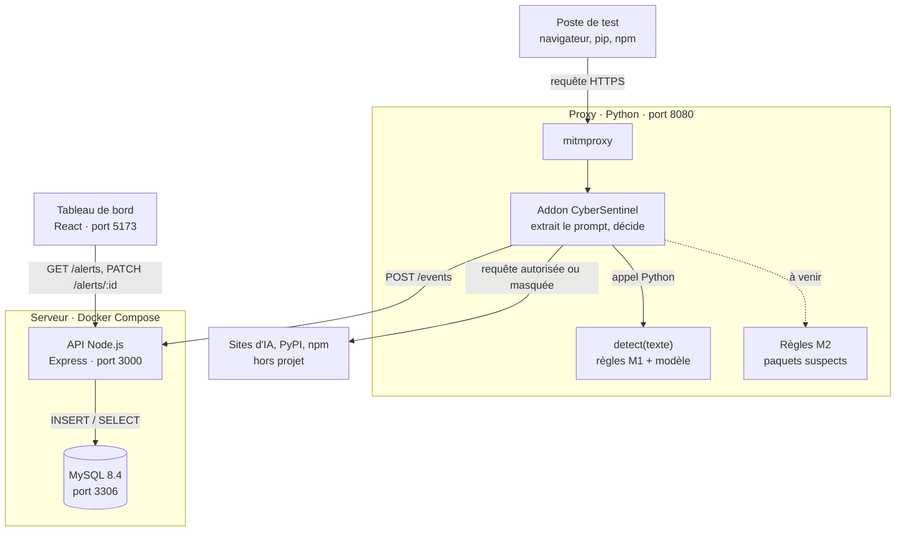
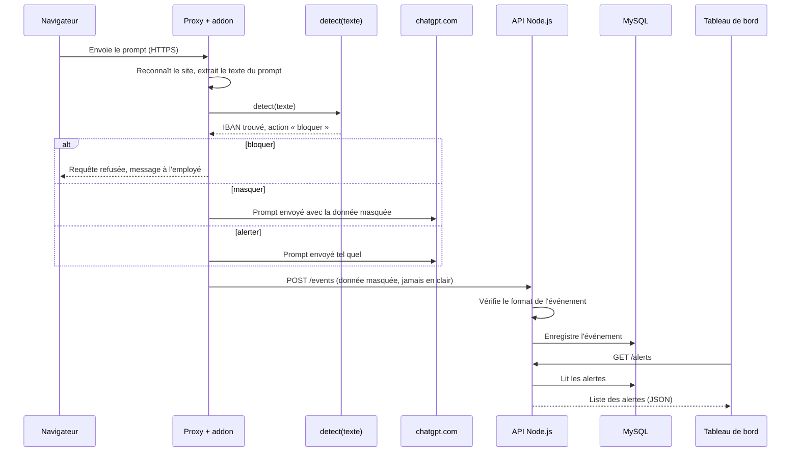

# Architecture de CyberSentinel

Carte #40. Version du 12/11/2026 (séance 2), à jour avec le passage de l'API en **Node.js + MySQL**.

CyberSentinel se place entre le poste de l'employé et Internet. Le proxy lit ce qui part vers les sites d'IA, la détection repère les données sensibles, l'API enregistre chaque décision et le tableau de bord les affiche.

## 1. Vue d'ensemble

## 2. Le trajet d'un prompt, étape par étape

Exemple : un employé colle un IBAN dans ChatGPT.

## 3. Les composants

| Composant | Technologie | Rôle | Où dans le dépôt | Responsable | État (12/11) |
| --- | --- | --- | --- | --- | --- |
| Proxy | mitmproxy (Python) | Intercepte le trafic HTTPS des postes de test | `proxy/`, `docs/proxy-installation-windows.md` | Arno | ✅ Voit le trafic des 5 IA |
| Addon | Python | Reconnaît le site, extrait le prompt, appelle `detect()`, applique la décision, envoie l'événement | `proxy/addon.py` | Arno | 🟡 Prototype, pas encore branché |
| Détection M1 | Python | Repère les données sensibles dans un texte | `detection/detect.py`, `rules/m1.yaml`, `rules/m1_detect.py` | Aloïs, Nolan, Imad | ✅ v1, rappel 60 % |
| Détection M2 | Python | Repère les paquets pip / npm suspects | `rules/m2.yaml` | Kiliann | 🔴 En cours |
| API | Node.js 22 + Express 5 | Reçoit les événements, sert les alertes au tableau de bord | `backend/`, `docs/api.md` | Fati | ✅ Routes faites et testées |
| Base | MySQL 8.4 | Stocke les événements (table `evenements`) | `backend/db/init.sql` | Fati | ✅ |
| Lancement | Docker Compose | Lance l'API et la base en une commande | `docker-compose.yml` | Fati | ✅ À tester sur chaque PC |
| Tableau de bord | React + Vite | Liste, détail, réglages, statistiques | `frontend/`, `docs/maquettes/` | Fati | 🟡 Page des alertes sur données factices |

## 4. Les échanges entre composants

| De | Vers | Comment | Format |
| --- | --- | --- | --- |
| Navigateur | Proxy | Proxy configuré sur `127.0.0.1:8080` + certificat mitmproxy installé | Requête HTTPS d'origine |
| Addon | Détection | Appel de fonction Python dans le même programme : `detect(texte)` | Liste de détections (`docs/detect.md`) |
| Addon | API | HTTP `POST http://localhost:3000/events` | Événement au format commun (`docs/format-evenement.md`) |
| API | Base | Requêtes SQL (bibliothèque `mysql2`) | Une ligne par événement |
| Tableau de bord | API | HTTP `GET /alerts`, `GET /alerts/:id`, `PATCH /alerts/:id` | JSON (`docs/api.md`) |

L'addon fait la **conversion** entre la sortie de `detect()` et le format d'événement : il ajoute `id`, `date`, `source`, `site_ia`, et transforme `categorie` en `etiquette`.

## 5. Les ports

| Port | Service |
| --- | --- |
| 8080 | Proxy mitmproxy |
| 3000 | API Node.js |
| 3306 | MySQL |
| 5173 | Tableau de bord en développement (`npm run dev`) |

## 6. Règles de sécurité de l'architecture

- **La donnée sensible ne quitte jamais le proxy en clair.** Elle est masquée avant l'envoi à l'API, et la base ne stocke que l'extrait masqué (200 caractères maximum).
- **Le proxy ne tourne que sur des postes de test** de l'équipe, avec des données fictives (`docs/rgpd.md`).
- **Les mots de passe de la base** sont dans un fichier `.env`, jamais sur GitHub (modèle : `.env.example`).
- **À faire** : l'API n'a pas encore de connexion ni de rôles. Elle ne doit être accessible que sur le réseau de test.

## 7. Ce qui reste à brancher

1. **L'addon → l'API** (Arno) : envoyer un événement à `POST /events` à chaque détection.
2. **Le tableau de bord → l'API** (Fati) : remplacer les données factices par `GET /alerts`.
3. **Les réglages** : une route `GET /settings` que le proxy lira pour savoir s'il faut bloquer, masquer ou alerter chaque type de donnée.
4. **M2 dans le proxy** : contrôler les requêtes vers PyPI et npm.

## Images des schémas

Pour le dossier ou une présentation : [`exports/png/architecture-vue-ensemble.png`](exports/png/architecture-vue-ensemble.png) et [`exports/png/architecture-trajet-prompt.png`](exports/png/architecture-trajet-prompt.png).
