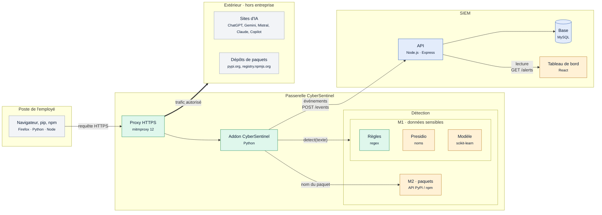
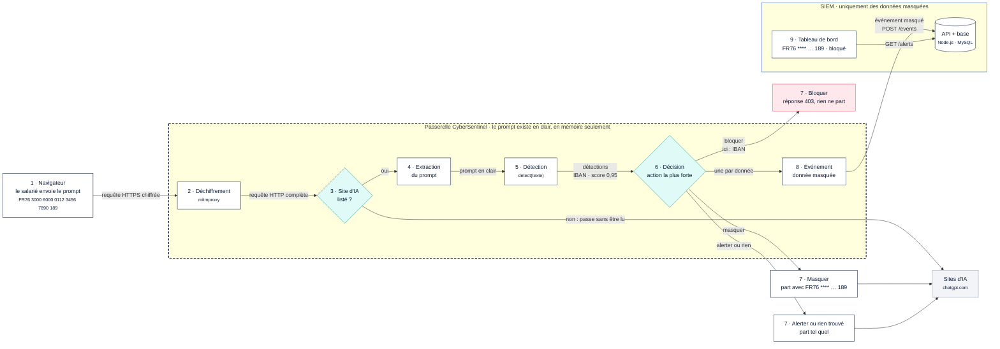

# Architecture de CyberSentinel

Carte #40. Version du 12/11/2026, d'après la description technique d'Arno, avec la stack réelle du SIEM : **API Node.js (Express) + MySQL**.

CyberSentinel est un proxy HTTPS qui lit ce que les salariés envoient aux IA, détecte les données sensibles et envoie une alerte à un tableau de bord. Le système compte 8 composants répartis sur 3 zones : le **poste de l'employé**, la **passerelle CyberSentinel** (proxy + détection) et le **SIEM** (API, base, tableau de bord). Les sites d'IA et les dépôts de paquets sont à l'extérieur.

## Schéma 1 : vue d'ensemble

| Couleur | Signification (12/11) | Composants |
| --- | --- | --- |
| 🟩 Vert | Fonctionne aujourd'hui | Proxy, addon (écrit les événements dans un fichier), règles M1 |
| 🟦 Bleu | Fait, pas encore branché à l'addon | API, base MySQL |
| 🟧 Orange | En cours | Presidio, modèle (rappel faible), M2, tableau de bord (page des alertes sur données factices) |

## Les composants

| Zone | Composant | Techno | Rôle | Dans le dépôt | Responsable |
| --- | --- | --- | --- | --- | --- |
| Poste | Navigateur, pip, npm | Firefox, Python, Node | L'employé écrit à une IA ou installe un paquet | — | — |
| Passerelle | Proxy HTTPS | mitmproxy 12 + certificat CyberSentinel | Intercepte et déchiffre le trafic vers les IA et PyPI / npm | `docs/proxy-installation-windows.md` | Arno |
| Passerelle | Addon CyberSentinel | Python (addon mitmproxy) | Reconnaît le site, extrait le prompt, appelle `detect()`, décide, crée l'événement | `proxy/cybersentinel.py` (branche `cyber`) | Arno |
| Passerelle | Détection M1 `detect()` | Python : règles regex, Presidio, modèle scikit-learn | Trouve les données sensibles dans un texte | `detection/detect.py`, `rules/m1.yaml` | Aloïs, Nolan, Imad |
| Passerelle | Détection M2 | Python + API PyPI / npm | Juge si un paquet est inventé ou piégé | `rules/m2.yaml` | Kiliann |
| SIEM | API | Node.js 22 + Express 5 | Reçoit les événements (`POST /events`) et les sert (`GET /alerts`) | `backend/`, `docs/api.md` | Fati |
| SIEM | Base | MySQL 8.4 (Docker) | Stocke les événements | `backend/db/init.sql` | Fati |
| SIEM | Tableau de bord | React + Vite | Liste des alertes, détail, réglages, statistiques | `frontend/`, `docs/maquettes/` | Fati |
| Extérieur | Sites d'IA | ChatGPT, Gemini, Mistral, Claude, Copilot | Reçoivent le prompt s'il est autorisé | `rules/sites_ia.yaml` | — |
| Extérieur | Dépôts de paquets | pypi.org, registry.npmjs.org | Fournissent les paquets | — | — |

## Schéma 2 : trajet d'un prompt (module M1)

Exemple : un salarié colle « Peux-tu vérifier ce virement vers FR76 3000 6000 0112 3456 7890 189 ? » dans ChatGPT. La décision se prend **avant** que la requête quitte l'entreprise.

La **ligne pointillée** autour de la passerelle marque **où la donnée sensible s'arrête** : à l'intérieur, le prompt existe en clair, en mémoire seulement. Au-delà, vers le SIEM, la donnée n'existe plus qu'en version masquée. Les sites d'IA reçoivent la requête seulement si l'action le permet.

Les 9 étapes :

1. **Navigateur → proxy.** Firefox envoie la requête HTTPS au proxy (réglage `127.0.0.1:8080` sur le PC de test). Le navigateur fait confiance au certificat CyberSentinel.
2. **Déchiffrement.** mitmproxy déchiffre le HTTPS et passe la requête complète (adresse, en-têtes, corps) à l'addon.
3. **Filtre des sites.** L'addon compare le domaine et le chemin à la liste des IA (`rules/sites_ia.yaml`). Tout autre trafic passe **sans être lu** (RGPD).
4. **Extraction du prompt.** L'addon décode le corps selon le site : formulaire (ChatGPT), JSON (Mistral, Copilot), protobuf (Claude), base64 + protobuf (Gemini).
5. **Détection.** `detect(texte)` lance les règles M1, puis Presidio (noms), puis le modèle. Résultat : une liste de détections (type, position, score, action, extrait masqué).
6. **Décision.** L'action la plus forte gagne : `bloquer` > `masquer` > `alerter`. Ici : IBAN → `bloquer`.
7. **Effet sur la requête.** *Bloquer* : le proxy répond lui-même 403, la requête ne part pas. *Masquer* : la donnée est remplacée par `****` puis la requête part. *Alerter* ou rien trouvé : la requête part telle quelle.
8. **Événement → SIEM.** L'addon crée un événement par donnée trouvée (jamais la donnée en clair) et l'envoie à `POST /events`. Aujourd'hui, il l'écrit encore dans `logs/evenements.jsonl`.
9. **Tableau de bord.** La page des alertes lit `GET /alerts` et affiche la date, le site, le type de donnée, l'action et l'extrait `FR76 **** **** **** **** **** 189`.

## Trajet d'un paquet (module M2)

M2 réutilise le même proxy, mais regarde les **téléchargements de paquets** au lieu des prompts. Ce trajet est encore en conception (Kiliann, cartes #34 à #37).

1. **pip ou npm → proxy.** Un développeur lance `pip install <nom>` (souvent un nom suggéré par une IA).
2. **Filtre.** L'addon repère les requêtes vers `pypi.org/simple/<nom>/` ou `registry.npmjs.org/<nom>` et lit le nom du paquet.
3. **Vérification.** La détection M2 interroge l'API PyPI ou npm : le paquet existe-t-il, depuis quand, combien de téléchargements, son nom ressemble-t-il à un paquet connu ? Les seuils sont dans `rules/m2.yaml`.
4. **Décision.** Paquet suspect → téléchargement bloqué ou alerte.
5. **Événement → SIEM.** Même format qu'en M1, avec `module: M2`, `site_ia: pypi.org`, `type_donnee: PAQUET_SUSPECT`. Même API, même tableau de bord.

## Les contrats entre composants

Trois interfaces séparent les composants. Chacune est documentée, ce qui permet à chaque filière d'avancer sans attendre les autres.

| Interface | Entre | Entrée | Sortie | Doc |
| --- | --- | --- | --- | --- |
| `detect(texte)` | Addon → détection | Le prompt en clair (`str`) | Liste de détections : `regle`, `categorie`, `score`, `action`, `debut` / `fin`, `extrait_masque`, `source` | `docs/detect.md` |
| Événement JSON | Addon → API | Une détection + le contexte (site, poste, date) | `id`, `requete_id`, `date`, `source`, `site_ia`, `type_donnee`, `regle`, `detecteur`, `score`, `etiquette`, `explication`, `action`, `extrait_masque`, `latence_ms` | `docs/format-evenement.md` |
| API REST | Addon et tableau de bord ↔ API | `POST /events` (un ou plusieurs événements) | `GET /alerts` (liste filtrable), `GET` et `PATCH /alerts/:id` | `docs/api.md` |

## Ports

| Port | Service |
| --- | --- |
| 8080 | Proxy mitmproxy |
| 3000 | API Node.js |
| 3306 | MySQL |
| 5173 | Tableau de bord en développement (`npm run dev`) |

## Règles de sécurité qui traversent tout le schéma

D'après la note RGPD d'Aloïs (`docs/rgpd.md`) :

- seul le trafic vers les sites listés est lu ;
- le prompt complet ne quitte jamais la passerelle : seul un extrait masqué de 200 caractères au plus part vers le SIEM ;
- le poste est identifié par un nom de machine, jamais par le nom d'une personne ;
- les mots de passe de la base sont dans un fichier `.env`, jamais sur GitHub.

L'API n'a pas encore de connexion ni de rôles : elle ne doit tourner que sur le réseau de test.

## Images des schémas

Pour le dossier Ydays ou une présentation : [`exports/png/architecture-vue-ensemble.png`](exports/png/architecture-vue-ensemble.png) et [`exports/png/architecture-trajet-prompt.png`](exports/png/architecture-trajet-prompt.png).
